<div align="center">

# ILLNESS

### The Terminal Emulator for the Terminally Ill.

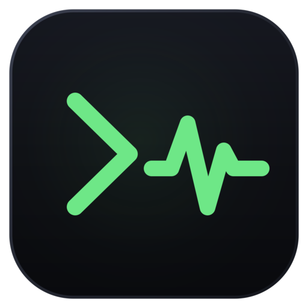

A Windows-first terminal built on Alacritty's VT core with its own egui shell: the same parser,
grid, scrollback and ConPTY plumbing, plus tabs, a command palette, real settings, and a window
that does not look like it was shipped in 1995.

</div>

## Screenshots

<div align="center">
  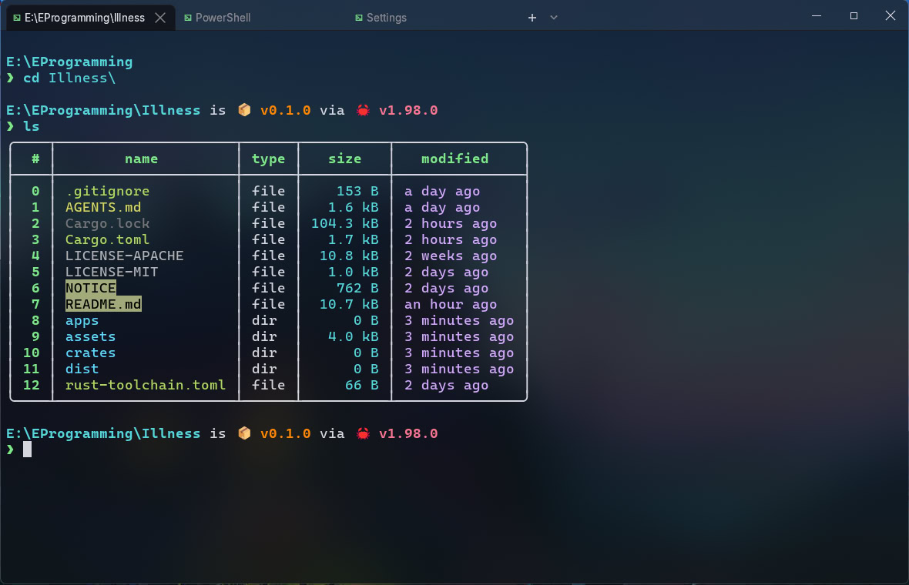
  
   <sub>Illness running with Acrylic window material</sub>
</div>

<br>

<table>
  <tr>
    <td width="50%">
      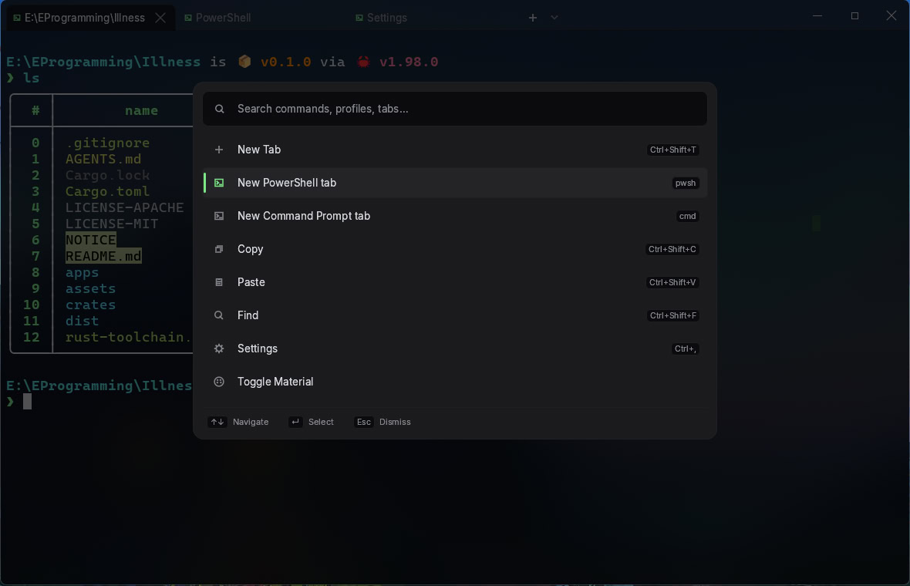
      <p align="center"><sub>Command palette</sub></p>
    </td>
    <td width="50%">
      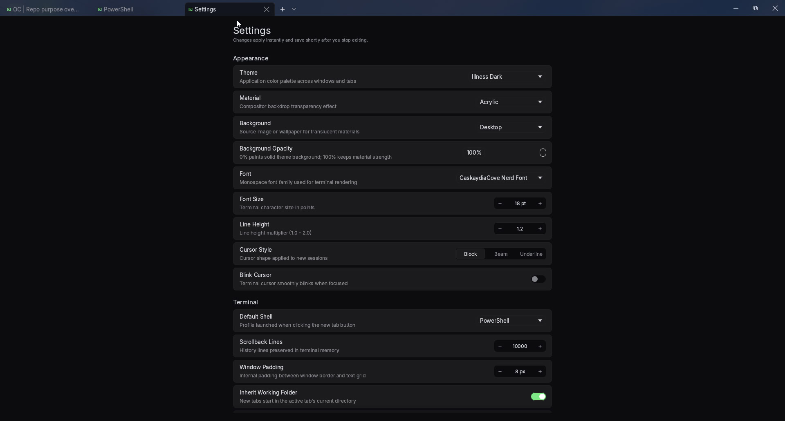
      <p align="center"><sub>Appearance and terminal settings</sub></p>
    </td>
  </tr>
</table>

<details>
<summary><b>More screenshots</b> — Profiles, settings & tabs</summary>

<br>

### Settings

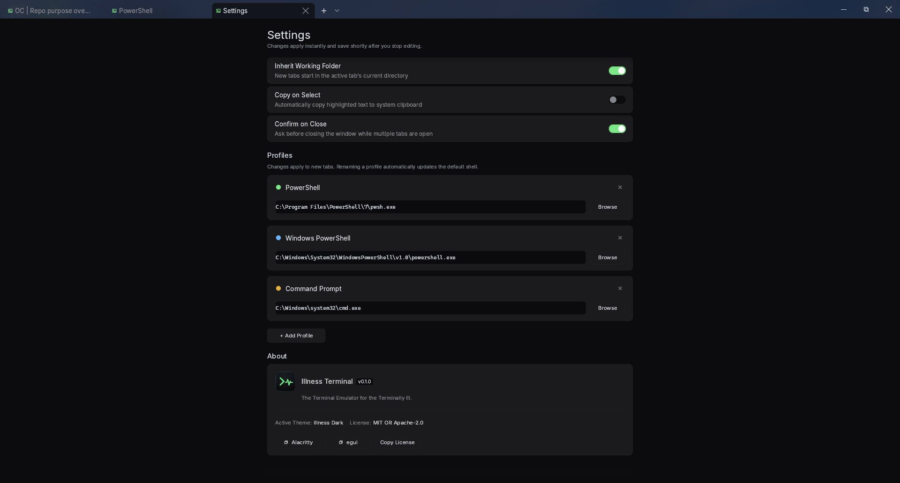

### New-tab dropdown

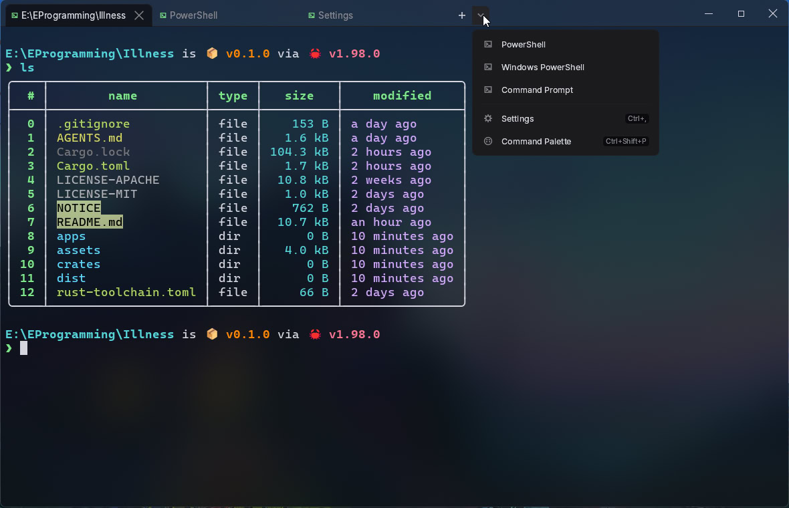

</details>

<details>
<summary><b>Window materials</b> — Solid vs Mica vs Acrylic</summary>

<br>

Illness supports three window materials. Compare how each looks across different views.

### Directory listing

| Solid | Mica | Acrylic |
|:---:|:---:|:---:|
| 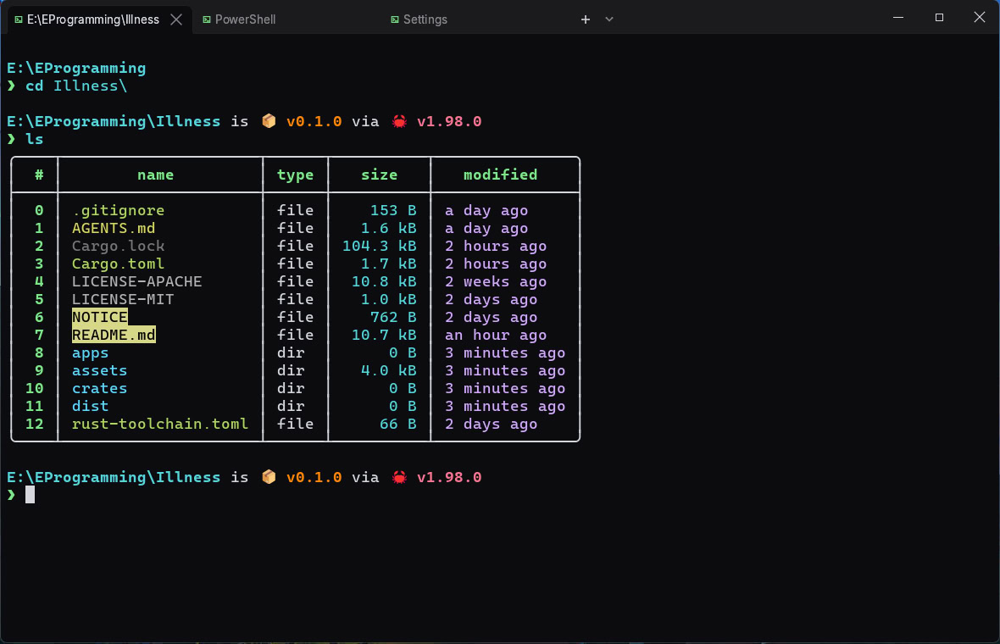 | 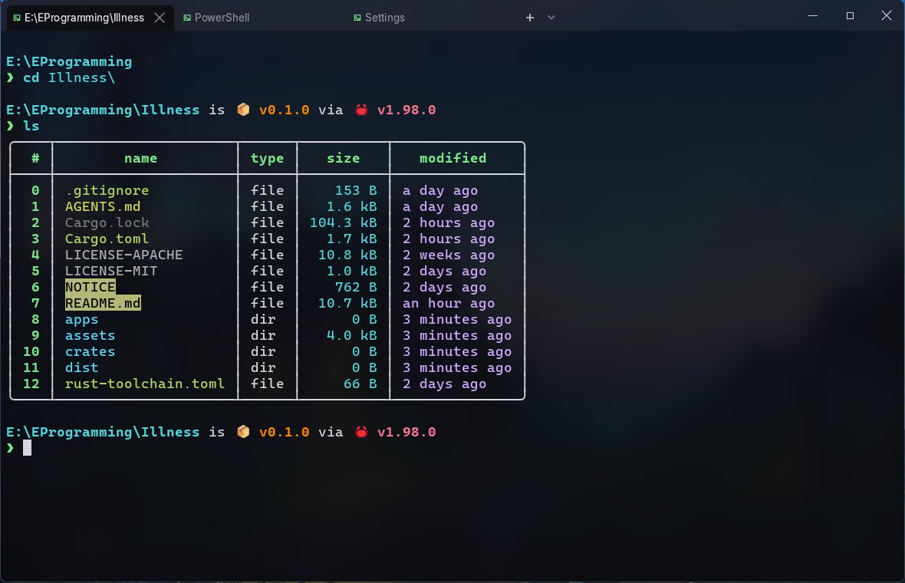 |  |

### Coding agent

| Solid | Mica | Acrylic |
|:---:|:---:|:---:|
| 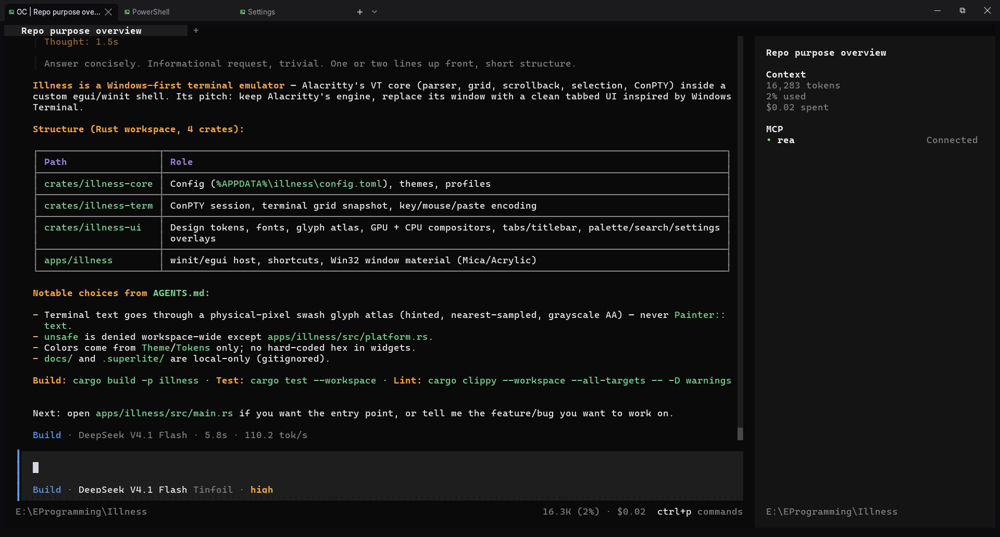 | 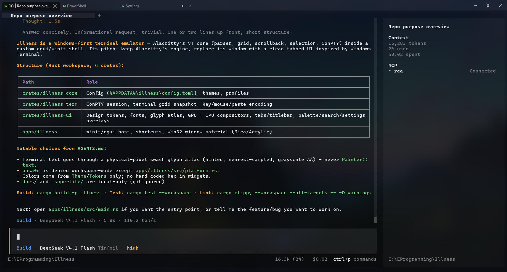 | 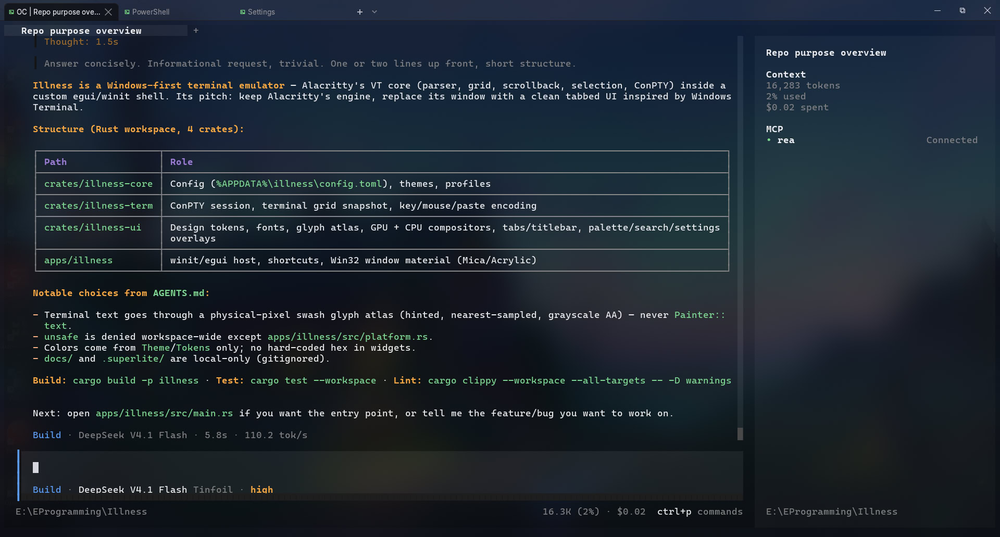 |

### Close confirmation

| Solid | Mica | Acrylic |
|:---:|:---:|:---:|
| 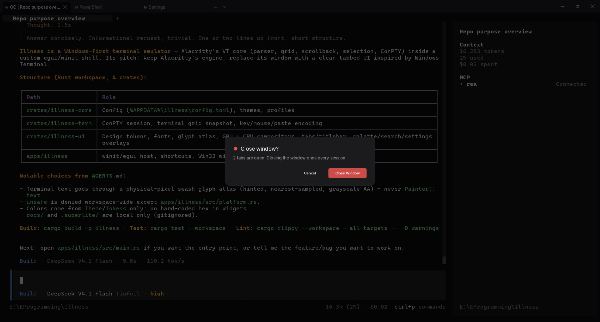 | 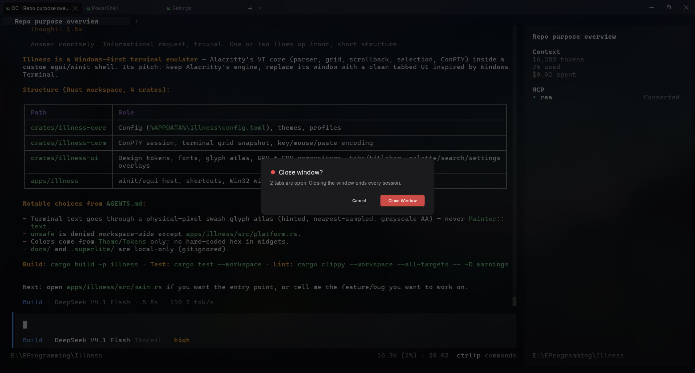 | 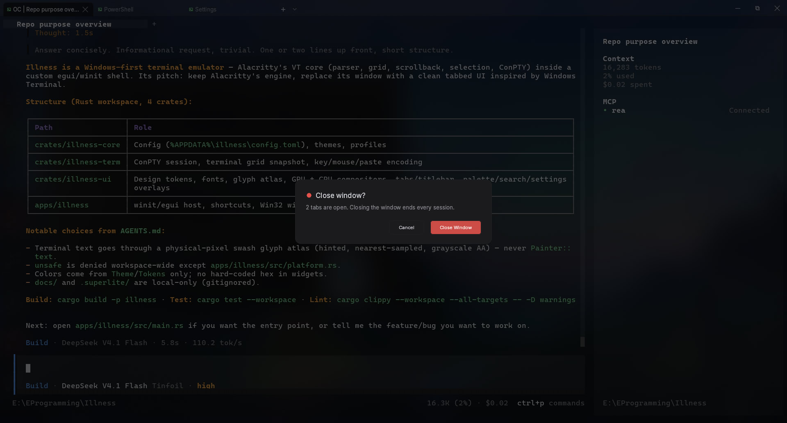 |

</details>

## Why?

Because the Windows terminal scene is either a bloated Electron app or a standalone console with
no window worth looking at. And because of a long-standing [Windows Terminal
issue](https://github.com/microsoft/terminal/issues/11916): typing turns to molasses the moment
anything CPU-heavy runs on the machine. See [latency workarounds](#latency-workarounds) for what
this one does about it.

And yes, it's personal.

## Take one now

Two ways in: grab a pre-built `illness.exe` or the installer from
**[Releases](../../releases)** (no toolchain needed), or build from source below.

From source. About 3 minutes the first time, almost all of it the initial build:

1. Install a stable Rust toolchain with the MSVC target: `winget install Rustlang.Rustup`, then
   `rustup default stable-msvc`.
2. Run `cargo run -p illness`.
3. Click the terminal and type.

Want the installer instead of a toolchain? Skip to [Windows installer](#windows-installer).

## Symptoms

- **Window and tabs.** Frameless winit/egui host, native caption buttons, profile accents, a real
  tab strip. Drag a tab to reorder it: it follows the pointer, leaves a landing slot, autoscrolls
  an overflowing strip, and activates on drop. Escape cancels; dropping outside the titlebar
  restores the original order.
- **Settings as a tab.** Right-aligned dropdowns, an editable shell profile list, an installed-font
  picker, background controls, and toggles that persist to `config.toml`.
- **Materials.** Solid by default; Mica or Acrylic in Settings, with Solid as the fallback whenever
  the API is unavailable. Mica is the Windows 11 backdrop. Acrylic is the legacy behind-window
  accent blur. Acrylic's Desktop mode is real blur; Mica's Desktop mode paints a blurred snapshot
  of the wallpaper that is rebuilt, not live. Wallpapers decode and blur on a detached thread.
  Native materials need Windows transparency effects; without them Illness stays Solid and shows
  the request as "(unavailable)" until you turn effects back on.
- **Renderer and input.** Pixel-snapped, hinted glyphs from a nearest-sampled physical-pixel atlas,
  drawn on the GPU from a grayscale mask (plus color emoji), with the CPU grayscale compositor as a
  fallback. Neutral antialiasing, no ClearType fringing. Wide cells, combining marks,
  underline/strikethrough, OSC 8 hyperlinks, every cursor shape, full xterm key and mouse encoding,
  bracketed paste, IME commit, focus reporting and DECSCUSR.
- **Power tools.** Command palette, inline search, and seven themes (Illness Dark, Campbell, One
  Half Dark, Nord, Gruvbox Dark, Solarized Dark, Light). 10,000 lines of scrollback with a real
  draggable scrollbar, word/line selection, and a shell lifecycle that closes finished tabs and
  turns an instantly-failing profile into a Restart / Settings / Close recovery card. Keys typed
  while a shell starts are buffered and delivered when it attaches.

## Prescription

| Action | Shortcut |
| --- | --- |
| New / close tab | `Ctrl+Shift+T` / `Ctrl+Shift+W` |
| Switch tab | `Ctrl+Tab` / `Ctrl+Shift+Tab`, or `Ctrl+1` … `Ctrl+9` |
| Palette / find / settings | `Ctrl+Shift+P` / `Ctrl+Shift+F` / `Ctrl+,` |
| Copy / paste | `Ctrl+Shift+C` / `Ctrl+Shift+V`, or `Ctrl+Insert` / `Shift+Insert` |
| Font size | `Ctrl+=` / `Ctrl+-` / `Ctrl+0` |
| Scroll | Mouse wheel, or drag the scrollbar |

Plain `Ctrl+C` always interrupts the shell, selection or not: the terminal owns it.

## Dosage

Requires Windows 10 1809+ and a stable Rust toolchain with the MSVC target. There is no exact
minimum version pinned; if the build complains about an edition or a lint, update with
`rustup update`.

```pwsh
cargo run -p illness
```

Release build (about a minute on a warm cache):

```pwsh
cargo build -p illness --release
```

The binary is `target\release\illness.exe`. Release builds use the Windows GUI subsystem, so
double-clicking it opens Illness directly instead of hosting a console in Windows Terminal.

### Opening a folder

```pwsh
illness.exe "E:\Files"
illness.exe C:\CLI
```

The positional folder is the launch folder. With **New tabs inherit current folder** enabled (the
default, `inherit_cwd = true` in `%APPDATA%\illness\config.toml`), a new tab starts in the active
shell's current directory; otherwise it uses the launch folder. The setting is captured when a tab
is spawned, so enabling it later does not retrofit open tabs.

Launched without a folder -- Start Menu, desktop shortcut, installed exe -- Illness starts in
`%USERPROFILE%`. Explorer sets the process directory to the executable's own folder, which says
nothing about where you were working, so it is ignored there. A real console launch from another
folder is honoured.

PowerShell 7 syncs its cwd through `LocationChangedAction` without touching `prompt`. Windows
PowerShell 5.1 has no equivalent hook, so Illness only wraps the built-in prompt there; a custom
5.1 prompt is left untouched, which preserves its `$?` but may leave the folder uninherited. A
cheap PEB read supplies the live shell cwd. Local candidates are probed inline on the spawn worker;
only network paths use a small probe pool, so a local path never waits behind a dead UNC share. A
per-tab deadline and cancellation token mean a closed tab stops waiting, and a shell that has not
started in ten seconds becomes a recovery card instead of a blank tab. A shell that `cd`ed into a
deleted folder or an offline share falls back; a cold launch folder survives a probe timeout.

### Explorer context menu

There are two unrelated mechanisms, and the difference decides whether you see the entry without
clicking anything.

**Registry verbs (legacy).** The per-machine installer writes **Open with Illness** verbs for folder
backgrounds, selected folders and drive roots (no file association) under `HKLM\Software\Classes`,
so they work for every user without a first launch. On Windows 11 these are the classic verbs, which
Explorer files under *Show more options*.

**Packaged entry (Windows 11 short menu).** The only way into the modern short menu is a sparse MSIX
package (`Simulp.Illness`) that declares the context-menu verbs and a COM surrogate, backed by
`illness_explorer_command_injector.dll` in the install directory. It ships inside the installer and
is registered per user by the installer when the machine allows it: on Windows 11 (build 22000 or
later) the installer tries the packed `.appx` first, and falls back to registering the loose manifest
unpacked into `$INSTDIR\appx\manifest`. Packed registration needs a package whose signature Windows
trusts; loose registration needs Windows Developer Mode. Neither is required for the app to work,
and neither is fatal to the installer -- the registry verbs stay either way.

While the machine verbs are complete they are authoritative: a normal launch deletes the current
user's stale HKCU copy so an older portable install cannot shadow HKLM. If HKLM is missing, partial,
or names a deleted executable, a launch from a stable installed location repairs the user's menu
with a per-user HKCU copy. A normal launch only touches the menu when running from `%ProgramFiles%`,
`%ProgramFiles(x86)%` or `%LOCALAPPDATA%\Programs`; a `target\debug`, temporary or USB copy will not
repoint an installed menu.

```pwsh
illness.exe --register-context-menu      # write the current copy's verbs
illness.exe --unregister-context-menu    # remove HKCU fallback and HKLM keys (elevate for HKLM)
```

The installer and uninstaller clean HKCU plus every loaded `HKEY_USERS` hive, so upgrades and
uninstalls do not leave other logged-on users' old verbs behind. An offline account's hive is not
mounted; its stale entry goes on that user's next launch once HKLM is complete.

### Windows installer

**Run this:** `.\apps\illness\build-installer.ps1` -> `dist\illness_0.1.0_x64-setup.exe`, about 2-3
minutes once the two prereqs are in place. Just want the binary? The
[Releases](../../releases) page has the standalone `illness.exe` and this installer.

Five steps, roughly 4-5 minutes cold, 2-3 warm:

1. Install the packager once (about 1 min): `cargo install cargo-packager --version 0.11.8 --locked`
2. Confirm the Windows SDK is installed, *Windows SDK for Desktop C++ x64 Apps* -- it supplies
   `makeappx.exe`. No SDK and no `.appx` in `dist\`? Step 3 stops and names the missing component
   (about 2 min to add via the Visual Studio installer).
3. Build the installer (about 2-3 min): `.\apps\illness\build-installer.ps1`
4. Run `dist\illness_0.1.0_x64-setup.exe` (UAC prompt, about 30 s).
5. Verify: right-click any folder and look for **Open with Illness** in the short menu.

Step 3 runs four phases, in this order:

1. `packaging\msix\build.ps1` builds the COM server DLL.
2. `makeappx pack` writes `dist\illness_explorer_command_injector.appx`.
3. `cargo packager --release` builds the release app and renders the NSIS template.
4. NSIS compiles the rendered script into the setup executable.

**What you get:** per-machine install in `%ProgramFiles%\Illness`, an All Users Start Menu shortcut,
a Programs and Features entry, and per-user settings in `%APPDATA%\illness`.

**What lands in `appx\`:** `illness.exe` stays in the install root (the package resolves it as
external content); the COM DLL and the `.appx` sit side by side in `appx\`; if signed registration
fails, the installer unpacks the `.appx` into `$INSTDIR\appx\manifest` and registers it from there,
because a registration pointing at `%TEMP%` dies with the folder.

**If the entry is missing from the short menu**, in this order:

1. Check *Show more options* -- the legacy registry verb is there and works.
2. Restart Explorer once; a fresh package registration is not always picked up live.
3. Confirm the package landed: `Get-AppxPackage -Name Simulp.Illness` should print `Status: Ok`.

**Signing, short version:** an unsigned package is rejected (`0x800B0100`), so the installer falls back
to loose registration, which needs Windows Developer Mode. Shipping the short-menu entry to other
machines needs a code-signing certificate whose subject is `CN=Simulp`, or a Store listing that
re-signs for you. Every switch and both trust errors are in `packaging/msix/README.md`.

**Removing it:** the uninstaller unregisters the package, deletes the machine verbs and every loaded
hive's copy, and removes the install directory. `%APPDATA%\illness` survives unless you tick the box.

### Uninstall

Settings > Apps > Illness, or run the uninstaller from the install folder. It removes the machine
verbs and the install directory; your `config.toml`, profiles and themes survive unless you let it
clean them.

## Side effects

Configuration lives at `%APPDATA%\illness\config.toml` and is written on exit. Profiles are detected
from the installed shells: PowerShell 7, Windows PowerShell, Command Prompt and WSL.

A config file that cannot be read or parsed is copied to `config.toml.bak` before Illness falls
back to defaults, so a hand-edited typo will not eat your theme and profiles.

## Contraindications

- No split panes, no vi mode, no sixel or kitty graphics. This dose is deliberately narrow.
- No tested Unix build. The code compiles toward one; nobody has promised it works.
- Materials need Windows transparency effects. Without them, Solid.
- Mica's Desktop mode is a rebuilt wallpaper snapshot, not continuous live blur.
- The VT core is Alacritty's, so escape-sequence coverage and its gaps are theirs.

## Latency workarounds

Illness pins the pseudoconsole API to the inbox `conhost.exe`. `alacritty_terminal` loads
`conpty.dll` by bare name, and a Windows Terminal or WezTerm install can put its own `conpty.dll` on
`PATH`; that host, `OpenConsole.exe`, echoes keystrokes far more slowly. The DLL search is
restricted to `System32`, so the load falls back to kernel32's `CreatePseudoConsole`. The
restriction is process-global: a `conpty.dll` shipped next to `illness.exe` is ignored. Set
`ILLNESS_CONPTY=auto` to leave the DLL search alone.

Illness raises the shell's own threads and its console host to above-normal priority, so a saturated
machine still echoes at a usable latency: about 302 ms unboosted versus 30 ms with all cores busy.
The shell is boosted per thread, not per process, because thread priority is not inherited — long
builds started inside Illness keep running at normal priority. `ILLNESS_NO_PRIORITY_BOOST=1`
disables it; `0`, `false`, `no`, `off` and unset all keep the boost.

Echo latency is measured with `crates/illness-term/examples/latency_probe.rs`.

## Prognosis

Apache-2.0 OR MIT. See `NOTICE` for upstream attribution, `THIRD-PARTY-LICENSES.md` for every
Rust dependency and its license text, and `assets/fonts/` for Cascadia Code and Inter.

## AI Disclosure

DeepSeek v4.1 Flash 1017 was used extensively for development.
