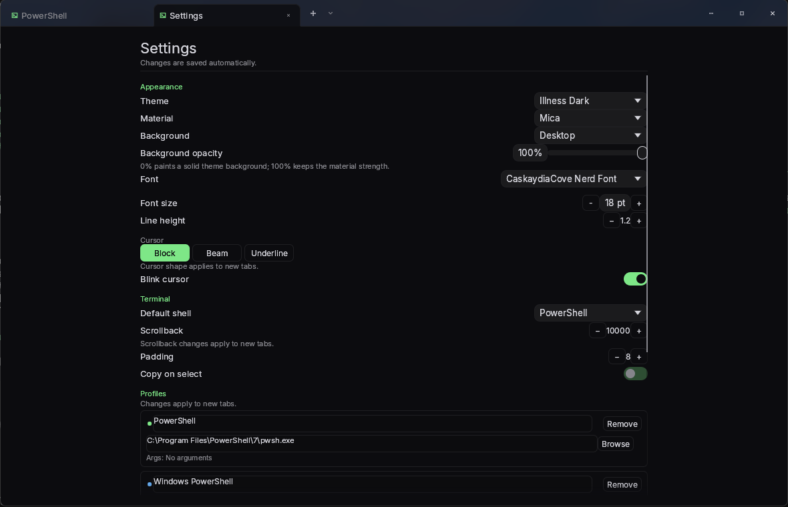

# ILLNESS

### The Terminal Emulator for the Terminally Ill.

A Windows-first terminal emulator built on Alacritty's VT core and egui, for people who think
Alacritty's UI is a war crime.

Illness keeps the parts of Alacritty that are actually good - the parser, grid, scrollback,
selection and ConPTY - and replaces the window you have to look at with a clean, dark, tabbed
shell inspired by Windows Terminal. It renders terminal text through its own physical-pixel
glyph atlas: hinted, pixel-snapped, nearest-sampled, with neutral grayscale
antialiasing (no ClearType color fringing).




## Symptoms

- Custom winit/egui window host with a frameless window, a real tab strip, profile accents and
  native caption buttons.
- Settings opens as its own tab, with right-aligned dropdowns, an editable shell profile list,
  an installed-font picker (Nerd Fonts included), and background controls.
- Mica by default; Acrylic or Solid in Settings. Mica is the Windows 11 system backdrop and
  falls back to Solid when unavailable. Acrylic uses the legacy native behind-window accent
  blur where Windows 10/11 expose it, and also falls back to Solid. Acrylic's Desktop mode is
  native behind-window blur; Mica's Desktop mode paints a decoded, blurred snapshot of the
  current wallpaper that is refreshed when the backdrop is rebuilt, not continuously live.
  Image uses the chosen custom image. Wallpapers are decoded and blurred on a detached thread,
  so switching to Mica or Image uploads an already-warmed texture instead of stalling the UI.
  The opacity slider affects a painted backdrop (Mica with Desktop or a loaded image) and
  Acrylic (including Acrylic with Background set to None, through its accent tint); Solid,
  Mica with no background, and Mica with an image that failed to load ignore it. Native
  materials also require Windows transparency effects to be on; otherwise Illness stays Solid
  but keeps the request in Settings as "(unavailable)". Turning transparency effects back on,
  or re-selecting the material, retries it without a restart.
- Command palette (`Ctrl+Shift+P`), inline search (`Ctrl+Shift+F`) and Settings (`Ctrl+,`).
- Seven themes: Illness Dark, Campbell, One Half Dark, Nord, Gruvbox Dark, Solarized Dark, Light.
- Crisp terminal grid with system fallback for CJK and emoji; wide cells, combining marks,
  underline/strikethrough, OSC 8 hyperlinks and all cursor shapes.
- Full xterm key and mouse encoding, bracketed paste, IME commit, focus reporting and DECSCUSR.
- 10,000 lines of scrollback, smooth wheel scrolling, word/line selection and a jump-to-bottom pill.
- A session that ends stays readable; Restart is one click away.
- Pixel-snapped, hinted glyphs on a nearest-sampled physical-pixel atlas. Glyphs are drawn on
  the GPU from a grayscale mask atlas (plus color emoji), while backgrounds, selection, search
  hits and the cursor stay pixel-exact; the CPU grayscale compositor remains as a fallback.

## Dosage

Requires Windows 10 1809+ and a Rust 1.98 toolchain with the MSVC target.

```pwsh
cargo run -p illness
```

Release build:

```pwsh
cargo build --release -p illness
```

The binary is `target\release\illness.exe`. Release builds use the Windows GUI subsystem, so
double-clicking it opens Illness directly instead of hosting a console in Windows Terminal.

## Prescription

| Action | Shortcut |
| --- | --- |
| New tab | `Ctrl+Shift+T` |
| Close tab | `Ctrl+Shift+W` |
| Next / previous tab | `Ctrl+Tab` / `Ctrl+Shift+Tab` |
| Select tab 1–9 | `Ctrl+1` … `Ctrl+9` |
| Command palette | `Ctrl+Shift+P` |
| Find | `Ctrl+Shift+F` |
| Settings | `Ctrl+,` |
| Copy / paste | `Ctrl+Shift+C` / `Ctrl+Shift+V` |
| Font size | `Ctrl+=` / `Ctrl+-` / `Ctrl+0` |
| Scroll | Wheel, `Shift+PageUp/PageDown` |

## Side effects

Configuration lives at `%APPDATA%\illness\config.toml` and is written on exit. Profiles are
detected from the shells installed on the machine: PowerShell 7, Windows PowerShell, Command
Prompt and WSL.

Known limitations in this dose: no split panes, no sixel/kitty graphics, no vi mode, and no
tested Unix build. Mica is the Windows 11 system backdrop. Acrylic uses the legacy native
behind-window accent blur where Windows 10 and 11 expose it; either material falls back to
Solid if its API is unavailable. The VT core is Alacritty's, so the usual escape-sequence
coverage applies.

## Prognosis

Apache-2.0 OR MIT. See `NOTICE` for upstream attribution and the licenses in `assets/fonts/`
for Cascadia Code and Inter.
